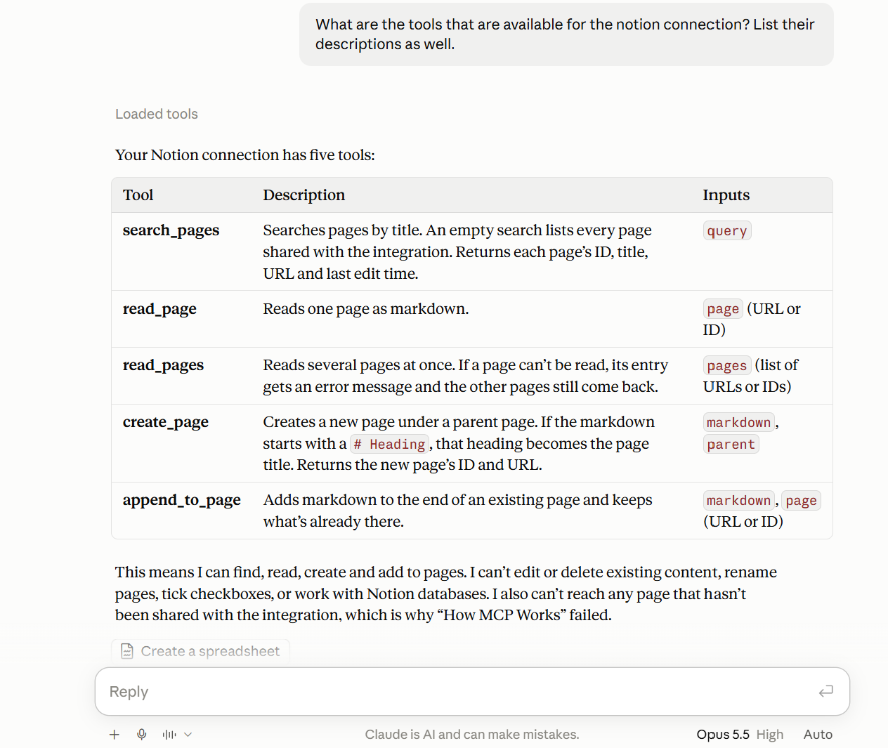
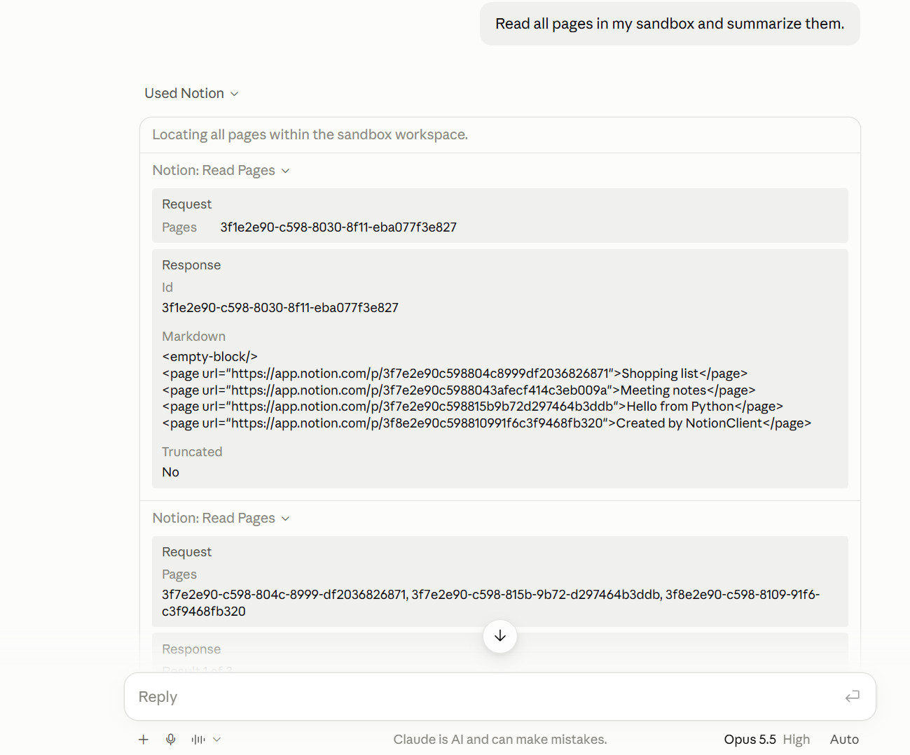
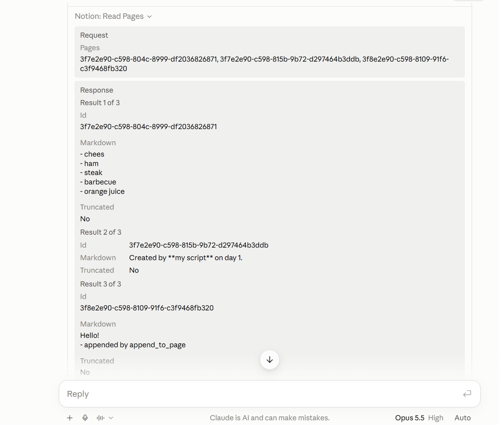
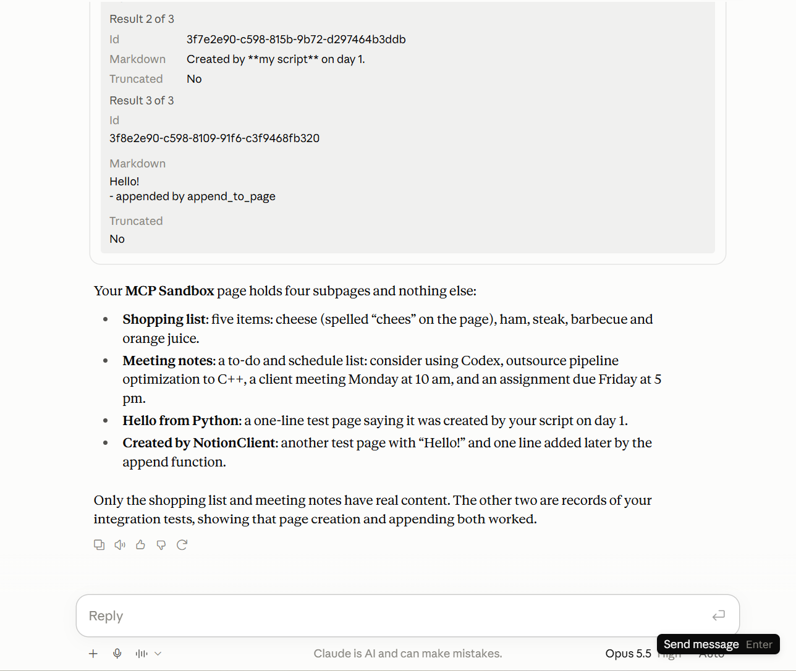
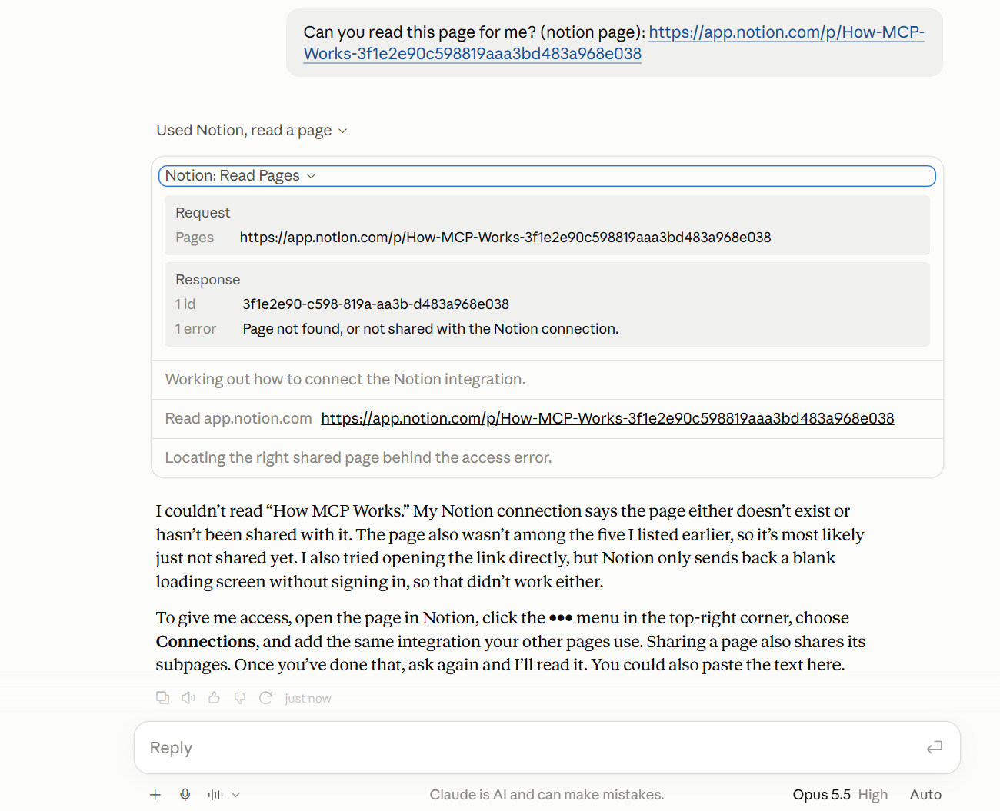

# Notion MCP server

An MCP server that lets Claude search, read and write pages in a Notion workspace.
Built with FastMCP and asyncio, runs in Docker, connects to Claude Desktop.


## Tools
| Tool | What it does |
|---|---|
| `search_pages(query)` | find pages by title (empty query = all shared pages), query = str |
| `read_page(page)` | read one page as markdown; page = str (accepts a URL or an ID) |
| `read_pages(pages)` | read up to 10 pages concurrently; failures are reported per page, pages = list[str] |
| `create_page(parent, markdown)` | create a page as a child of the 'parent'; the first `# heading` becomes the title, parent = str |
| `append_to_page(page, markdown)` | add markdown at the end of a page, page = str |


## Demo

### Claude sees the five tools


### Reading several pages at once
`read_pages` fetches the pages concurrently (at most 3 requests in flight).





### Least privilege: a page that isn't shared with the connection
Claude gets a clear error instead of the page's content.



## Setup
1. In Notion: Settings → Connections → Add connection (Developer connection) (choose connection name here) → New connection → authentication "API token", capabilities Read, Update and Insert content. Copy the token.
2. Share one page (e.g. "MCP Sandbox") with the connection: page ••• menu (top right) → ••• more → search for "connection name" → Add to page. The server can only see that page and its children.
3. `cp .env.example .env` and put the token in `.env`.
4. `docker build -t notion-mcp .`
5. Add to `claude_desktop_config.json` ("notion" is the server's name)
```json
   {
     "mcpServers": {
       "existing-mcp-server": { "...": "keep your existing entry exactly as it is" },
       "notion": {
         "command": "docker",
         "args": [
           "run", "-i", "--rm",
           "--env-file", "C:\\Users\\user-name\\...\\notion-mcp\\.env",
           "notion-mcp"
         ]
       }
     }
   }
```
6. Restart Claude Desktop. Closing does not suffice: quit/exit the app (Windows: right click on the Claude desktop icon located on the taskbar → Exit).

## Development
```
uv sync
uv run pytest
uv run ruff check .
```
Tests use a fake Notion (`httpx.MockTransport`) and an in-memory MCP client, so they need no token and no network.

Run server directly from IDE/command line (no Claude client):
`uv run --env-file .env notion-mcp`

## Architecture
```
config.py      settings from environment variables (fails immediately without a token)
notion_ids.py  pure helpers: page URL → ID, page titles
notion_api.py  async NotionClient: HTTP, error types, retries, concurrency limit
server.py      FastMCP tools: a light layer over NotionClient
```

## Design decisions
- **Least privilege:** an internal connection shared with one sandbox page, not a personal access token for the whole workspace.
- **Concurrency limit:** an `asyncio.Semaphore(3)` shared by all requests; at most 3 requests in flight at once are allowed by this restriction. This lowers the chance of hitting Notion's limit (~3 requests/second on average) but doesn't guarantee it.
- **Retries:** on HTTP 429 the client waits for `Retry-After` (with `asyncio.sleep`, outside the semaphore) and retries up to 3 times (MAX_RETRIES). The 3rd unsuccessful retry results in an error.
- **Partial failure:** `read_pages` uses `gather(return_exceptions=True)`, so one inaccessible page doesn't fail the others.
- **Errors for Claude:** Notion errors become `ToolError` with an actionable message; unexpected errors are masked (`mask_error_details=True`) so possibly sensitive internal data don't leak.
- **Secrets:** the token lives only in `.env` (gitignored, excluded from the Docker image, hidden from `repr`).
- **Known trade-off:** appending uses Notion's `insert_content` markdown operation, which is marked deprecated; the recommended (non-deprecated) alternatives are update_content = search and replace old_str → new_str, and replace_content = replace the whole page with new markdown.
1. To replicate the append command using those two operations requires two separate requests to the server; any change of the queried Notion page happening in between the two requests results in an undesired outcome (e.g. I request to read the page and someone writes the word 'dog' on it, then I update the page with old content + addition. In the process the word 'dog' is lost because my update was based on an outdated version of the page.)
2. The deprecated call is isolated in `NotionClient.append_to_page`, so switching later changes one method and its test.

## Limitations and next steps
- Many pages: search returns only the first 10 results - the remaining pages need to be searched for using a more specific title.
- Long pages: pages above a certain length get truncated; this fact is signaled to Claude but never acted upon
- Safe mode: no read-only mode - writing tools are always available
- Prompt injection: page content goes to Claude unfiltered
- Errors: the 5xx errors are not retried
- Fixed fallback: no exponential backoff present (wait time exponentially increasing with failed attempts)

## How I used AI
I followed a 90-step tutorial created by Claude over three days. This tutorial offered guidance on installing dependencies, communication with GitHub and snippets of code to compose the entirety of the project. I inspected/wrote out the code line by line, always attempting to understand the code proposed by the tutorial. I explored further with follow-up questions about unclear concepts (asyncio & semaphore, yield, fixtures...). I ran the tests after each part, sometimes deliberately changing up the code to provoke a failure.
